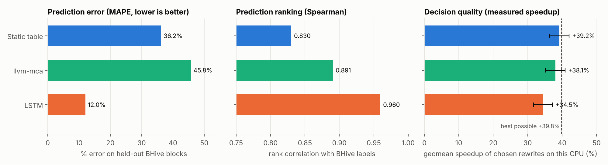

# NeuroOpt

**Throughput-aware peephole optimization with a learned cost oracle.**

NeuroOpt looks at a basic block of x86-64 machine code, generates only *legal*
alternative encodings (symbolic guards decide legality), and lets a swappable
**cost oracle** pick the fastest one. The oracle can be a fixed per-opcode table,
llvm-mca, or an embedding + hierarchical LSTM trained on measured BHive
throughput. The project then checks whether better prediction gives better
**decisions**, measured on real hardware.

> Guards decide what is allowed; the oracle decides what is fastest.
> Model predictions never override legality.

## Headline results



| | Static table | llvm-mca | LSTM (this project) |
|---|---|---|---|
| Prediction MAPE on 3,000 held-out BHive blocks | 36.2% | 45.8% | **12.0%** |
| Prediction Spearman | 0.830 | 0.891 | **0.960** |
| Decisions: geomean **measured** speedup of chosen rewrites (1,082 blocks; best possible +39.8%) | **+39.2%** | +38.1% | +34.5% |
| Blocks made faster / slower (>2%) | 75.0% / 3.4% | 70.5% / 1.8% | 68.1% / 1.8% |

* **Correctness:** with guards on, 0 illegal rewrites in 2,600 fuzzed candidates and 0 in 1,464
  decision-set candidates. With guards off, the emulator catches 1,672 of the 1,864 rewrites the
  guards would refuse (so the harness is able to fail).
* **Prediction (M2):** the LSTM reaches 12.5% MAPE on the full test split and 15.0% on whole
  programs never seen in training (sqlite, redis, openssl).
* **Research question:** *No.* The best predictor made the worst decisions. Its picks are 3.4% slower
  than the static table's (95% CI 2.6 to 4.3%). The LSTM under-predicts the real gains of R2/R3 and
  calls R1 a slowdown, so it keeps the slower original too often. Low prediction error did not
  give better optimization choices.
* **Worked example (slide 23):** proxy score 6.00 → 2.25; **measured** 3.00 → 1.04 cycles/iteration on
  this CPU. Swapping only the oracle: static ×2.90, llvm-mca ×2.82, LSTM ×1.00 (it misses the imul chain).

Full tables, ablations, τ sweep and diagnosis: [`results/RESULTS.md`](results/RESULTS.md).

> **Read before quoting the +39% headline.** The decision set is 1,073 *seeded* blocks (inverse rewrites and inserted
> `mov r, r` no-ops) plus 9 natural ones; R3 (deleting the inserted self-moves) is 890 of 1,242 single-rule sites, so
> "apply every legal rule" scores the same as the static table. The v2 natural-code experiment (below) finds a real
> headroom of about 1% and no learned-oracle edge. See [`IMPROVEMENTS.md`](IMPROVEMENTS.md).

## v2: fixes and natural-code experiments
Two bugs fixed (timer calibration on newer Intel cores; emulator false "illegal" verdicts), an optional extended
rule pack, a natural held-out decision benchmark with a test-retest design, and a natural-code guard audit
(0 illegal of 4,382 with guards on; 1,605 of 7,579 with guards off). Details and caveats: [`IMPROVEMENTS.md`](IMPROVEMENTS.md).
Run: `bash scripts/run_natural.sh` (use a quiet machine).

---

## Pipeline

```
              ┌──────────── exact operands ────────────┐
bytes ─► M1 Decode ─┤                                         ├─► Oracle + Select ─► Emit ─► Verify
 (Capstone)         └─► M2 Tokenize (lossy) ─► model input ───┘   (argmin, gain > τ)   (bytes)  (Unicorn)
                                M4 Rewrite + guards (flag liveness) ─► C(B) ∪ {B}
```

| Stage | File | What it does |
|---|---|---|
| M1 Decode | `neuroopt/decode.py` | Capstone, exact operands; rejects partial/invalid decodes and mid-block control flow |
| M2 Tokenize | `neuroopt/tokenizer.py` | mnemonic + register / `<IMM>` / `<MEM>` tokens, ids, lengths, masks. Lossy, never used for legality |
| Flags | `neuroopt/flags.py` | `live_before = reads ∪ (live_after − kills)`; conservative defaults (all flags live at exit, jumps/unknown read all, shift-by-CL kills nothing, `cmc` reads CF) |
| M4 Rewrite | `neuroopt/rules.py` | R1 `mov r,0 → xor r,r`, R2 `imul r,r,2^k → shl r,k` (all six flags dead), R3 delete `mov r64,r64` (64-bit only); refusals carry their reason |
| Oracle | `neuroopt/oracle.py`, `neuroopt/model.py` | `score(block)`: `StaticOracle`, `MCAOracle`, `LSTMOracle`; same interface |
| Select | `neuroopt/selector.py` | `B* = argmin ĉ(B')` over `C(B) ∪ {B}`, accepted only if `ĉ(B) − ĉ(B') > τ`; greedy and exhaustive |
| Emit | `neuroopt/emit.py` | untouched instructions keep their bytes; rewritten ones are assembled with Keystone |
| Verify | `neuroopt/verify.py` | runs original and rewrite in Unicorn on random register/flag states; GPRs, xmm, written memory must match, flags compared only where defined |
| Hardware timing | `neuroopt/hwtime.py`, `hwtime.c` | times register-only blocks in a hot loop on this CPU, in core cycles |

## Quick start

```bash
pip install -r requirements.txt             # also needs gcc and llvm-mca (LLVM 18) on PATH
python -m pytest                             # 25 tests (two time real hardware)

# optimize one block (the slide-23 worked example)
python -m neuroopt optimize --asm "mov rax, 0; imul rbx, rbx, 8; mov rcx, rcx; add rax, rbx" --measure
python -m neuroopt optimize --hex 48c7c000000000486bdb084889c94801d8 --oracle lstm
python scripts/demo.py                       # worked example + the three legality traps + oracle swap
```

## Reproducing every result

```bash
./scripts/download_bhive.sh                  # BHive labels, categories, program sources (~90 MB)
python scripts/prepare_bhive.py              # M1: manifest + splits     -> data/processed, results/m1_*.json
python scripts/fuzz_guards.py --blocks 3000  # correctness: guards on/off -> results/fuzz_guards.json
./scripts/train_all.sh                       # M2: main LSTM, held-out families, ablations (~2 h on 3 CPU cores)
python scripts/evaluate_prediction.py        # MAPE / MAE / Spearman: static vs llvm-mca vs LSTM
python scripts/build_decision_set.py         # decision benchmark (held-out BHive blocks)
python scripts/evaluate_decisions.py         # M3: hardware-timed decision evaluation
python scripts/make_report.py                # results/RESULTS.md + results/figures/*.png
```

The trained models are in `models/` (`lstm_main.pt` is the oracle).

## Experimental design

* **Data contract (M1).** Each record: `block_id, hex_bytes, instruction_tokens, cpu_arch, target_y, split`.
  `target_y` is BHive Skylake throughput in cycles/iteration. Blocks with identical token sequences
  always share a split (no near-duplicate leakage). A second split holds out whole programs
  (sqlite, redis, openssl) to test generalization to unseen code.
* **Prediction (M2).** Held-out test blocks; MAPE, MAE, Spearman, Kendall. llvm-mca is run on a
  fixed random sample of the same blocks. The static table gets one global scale fitted on
  train, so its MAPE is not penalized for units; its ranking metrics are scale-free.
* **Decisions (M3).** *Hold the candidates fixed, change only the ranking.* Every candidate in
  every pool is verified in the emulator and timed on this CPU. Each oracle's pick is scored by
  its measured time: win rate, regression rate, regret against the best candidate, and
  geometric-mean speedup with a bootstrap 95% CI, plus a τ sweep.
* **Why a seeded decision set.** Compilers already apply R1 to R3 almost everywhere. In all of
  BHive only 181 blocks have a *legal* opportunity (9 register-only), while the guards refuse
  1,417 `mov r32,r32` zero-extensions and 532 `mov r,0` with live flags. The decision set
  therefore takes held-out register-only BHive blocks and applies inverse rewrites
  (`xor r,r → mov r,0`, `shl r,k`/`add r,r → imul r,r,2^k`, inserted `mov r64,r64`).
  The guards then decide legality exactly as for real code.
* **Timing methodology.** A 100×/200× straight-line unroll (as in BHive) turned out to be
  front-end bound for short blocks. It even made `xor r,r` look slower than `mov r,0`, and the
  effect flipped with the unroll factor. The harness therefore times the block in a hot loop
  (`body×K; dec; jnz`), with K and 2K copies and the same trip count, so the loop overhead
  cancels. It recovers textbook latencies (imul 3, shl 1, 4 ALUs → 0.25 per zero idiom).

## Scope and honest limits

* Three rule families; 32/64-bit general-purpose registers; six arithmetic flags.
* Per-basic-block analysis, with flags assumed live at exit.
* Greedy (or exhaustive over a capped pool) selection, not optimal search.
* Guards are **tested, not formally proven** (emulator plus random states).
* Hardware timing covers register-only blocks on one CPU (Cascade Lake, a Skylake-family core),
  while the LSTM labels come from BHive's Skylake client machine.
* The static-table "6.00 → 2.25" is a **proxy score**, not a speedup. Hardware numbers are
  reported separately and always labelled as measured.
