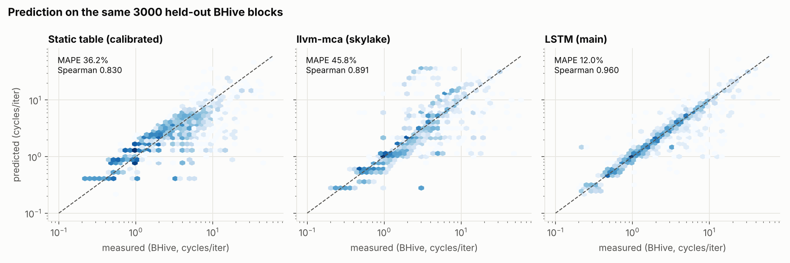
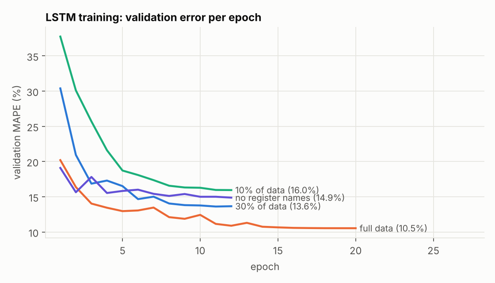
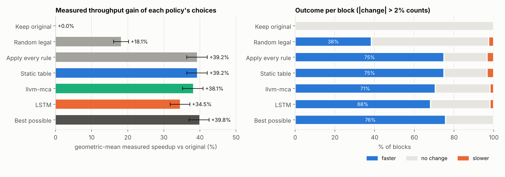
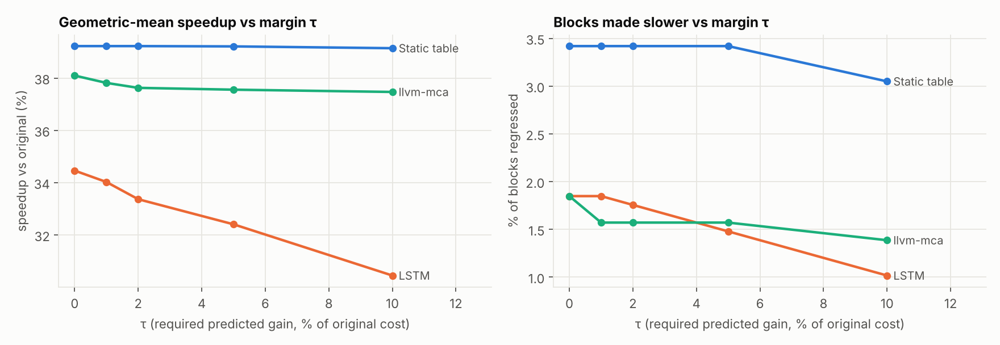
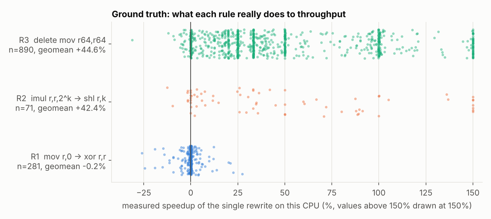

# NeuroOpt — results

All numbers below are produced by the scripts in this repository and saved as JSON in `results/`.

## Answer to the research question

> *Does a learned block-throughput model select better legal rewrites than a fixed-cost table?*

**No, not in this setting.** The LSTM is by far the best *predictor* (MAPE 12.0% vs 36.2% static, 45.8% llvm-mca), yet it makes the *worst* decisions: its picks give +34.5% measured geomean speedup vs +39.2% for the static table (upper bound +39.8%). On the same blocks, the LSTM's choices are 3.4% slower than the static table's (95% CI 2.6 to 4.3%). Ordered by rank correlation (Spearman: LSTM > llvm-mca > static), the three oracles come out in exactly the reverse order at the decision level (static > llvm-mca > LSTM). Low prediction error did **not** translate into better optimization choices. This is the link the project set out to test, and the hypothesis is not supported for these three rules on this CPU.

Why: the decision only needs the *sign* and rough size of each rewrite's gain. All three rules are almost never harmful on this CPU, so a table that always says "faster" is nearly optimal. The LSTM under-predicts the gains of R2 and R3 and predicts R1 as a slowdown, so it often keeps the slower original (see the diagnosis table in section 4).

## 1. Correctness (guards + emulator harness)

Random register-only blocks dense in rewrite sites and flag traps: **3,000 blocks**, 32 random register/flag states per check.

| Experiment | Result |
|---|---|
| Guards ON — single-step rewrites | **0 illegal of 1,858** |
| Guards ON — multi-step candidates | **0 illegal of 742** |
| Guards OFF — rewrites a guard would refuse | 1,864 |
| Guards OFF — of those, caught by the harness | **1,672** (89.7%) |
| Guards OFF — guard-approved rewrites flagged by harness (false alarms) | 0 |
| Decision set — every candidate in every pool, emulator check | 1,464 equivalent, 0 illegal, 0 not runnable in the emulator |

The guards-off row is what makes the guards-on row meaningful: the harness *can* catch bad rewrites. The uncaught guard-refused rewrites are conservative refusals (e.g. flags assumed live at block exit) where no difference is observable. This is strong evidence, **not a proof**.

## 2. Data (M1)

BHive Skylake throughput labels: 314,876 blocks → **314,173 kept** (703 dropped: >64 instructions or label outside (0, 100] cycles; 0 decode failures). 222,445 distinct token sequences; identical-token blocks always share a split.

* Random group split: train 251,792 / val 31,228 / test 31,153
* Program-family split (sqlite,redis,openssl held out): train 236,324 / val 25,544 / test 9,053 (41,239 blocks shared with held-out programs excluded)
* Register-only (timeable on this machine): 53,232

## 3. Prediction (M2)

Same 3000 held-out test blocks for all three (0 blocks llvm-mca could not parse were dropped from the comparison):

| Model | MAPE | MAE (cycles) | Spearman | Kendall |
|---|---|---|---|---|
| static (calibrated) | 36.2% | 1.203 | 0.830 | 0.700 |
| llvm-mca(skylake) | 45.8% | 1.748 | 0.891 | 0.751 |
| lstm[main] | 12.0% | 0.514 | 0.960 | 0.865 |

Static table MAPE uses one global scale fitted on train (×0.417); its ranking metrics are scale-free.

Full test split (31,153 blocks):

| Model | MAPE | Spearman |
|---|---|---|
| static (calibrated) | 37.6% | 0.825 |
| lstm[frac10] | 16.7% | 0.901 |
| lstm[frac30] | 14.5% | 0.921 |
| lstm[main] | 12.5% | 0.958 |
| lstm[noreg] | 16.2% | 0.934 |

Held-out program families (sqlite, redis, openssl, 9,053 blocks never seen in training): LSTM MAPE **15.0%** (Spearman 0.945); static table 36.0%.

Ablations: `main` = full data with register names; `noreg` = tokens without register names; `frac30`/`frac10` = 30% / 10% of the training set.

## 4. Decisions (M3) — the research question

**1,082 blocks**, every candidate timed on this CPU (Intel(R) Xeon(R) Processor @ 2.80GHz, median of 5 interleaved rounds × 7 trials; median run-to-run CV 0.1%). Candidate pools are identical for every oracle; only the ranking changes. A change counts only if larger than 2%. A measurably faster candidate exists in 75.5% of blocks.

| Policy | Geomean speedup (95% CI) | Faster | Slower | Mean regret | Picks best |
|---|---|---|---|---|---|
| keep original | +0.00% (+0.00, +0.00) | 0.0% | 0.0% | 48.8% | 24.3% |
| apply every legal rule | +39.22% (+36.34, +42.04) | 75.0% | 3.4% | 0.5% | 95.5% |
| random legal candidate | +18.12% (+16.07, +20.24) | 38.4% | 2.6% | 24.2% | 59.1% |
| static τ=0 | +39.22% (+36.34, +42.04) | 75.0% | 3.4% | 0.5% | 95.5% |
| lstm τ=0 | +34.46% (+31.74, +37.20) | 68.1% | 1.8% | 5.4% | 88.6% |
| llvm-mca(cascadelake) τ=0 | +38.10% (+35.17, +40.88) | 70.5% | 1.8% | 1.4% | 92.3% |
| best measured (upper bound) | +39.81% (+36.99, +42.54) | 75.7% | 0.0% | 0.0% | 100.0% |

Paired comparison on the same blocks (τ=0): geomean ratio of measured time of B's pick to A's pick (> 1 means A picks faster code):

| A vs B | Ratio (95% CI) | A's pick faster | B's pick faster |
|---|---|---|---|
| lstm vs static | 0.966 (0.957, 0.974) | 1.8% | 9.0% |
| llvm-mca(cascadelake) vs static | 0.992 (0.989, 0.995) | 2.0% | 5.2% |
| llvm-mca(cascadelake) vs lstm | 1.027 (1.018, 1.037) | 8.1% | 4.4% |

Diagnosis: predicted vs measured gain of each single rewrite (geomean of original/rewritten; 'says faster' = share of cases where the oracle predicts more than 2% gain):

| Rule | Measured | Static table | llvm-mca | LSTM |
|---|---|---|---|---|
| R1 | -0.2% (12.5% faster) | +26.7% (100.0% faster) | +20.6% (73.3% faster) | -3.5% (33.5% faster) |
| R2 | +42.4% (77.5% faster) | +36.9% (100.0% faster) | +45.0% (66.2% faster) | +14.6% (49.3% faster) |
| R3 | +44.6% (85.1% faster) | +36.2% (100.0% faster) | +40.0% (79.2% faster) | +23.5% (86.4% faster) |

Pairwise ranking accuracy inside pools (pairs whose measured times differ by more than 2%):

| Oracle | Pairs | Correctly ordered |
|---|---|---|
| static | 1,821 | 89.1% |
| lstm | 1,821 | 83.1% |
| llvm-mca(cascadelake) | 1,821 | 82.8% |

Measured effect of each single rule (ground truth):

| Rule | n | Geomean speedup | Faster | Slower |
|---|---|---|---|---|
| R1 | 281 | -0.25% | 12.5% | 12.1% |
| R2 | 71 | +42.40% | 77.5% | 2.8% |
| R3 | 890 | +44.62% | 85.1% | 2.5% |

τ sweep (relative margin):

| Oracle | τ=0 | τ=0.01 | τ=0.02 | τ=0.05 | τ=0.1 |
|---|---|---|---|---|---|
| static | +39.22% / 3.4% slower | +39.22% / 3.4% slower | +39.22% / 3.4% slower | +39.21% / 3.4% slower | +39.14% / 3.0% slower |
| lstm | +34.46% / 1.8% slower | +34.03% / 1.8% slower | +33.37% / 1.8% slower | +32.41% / 1.5% slower | +30.45% / 1.0% slower |
| llvm-mca(cascadelake) | +38.10% / 1.8% slower | +37.82% / 1.6% slower | +37.63% / 1.6% slower | +37.56% / 1.6% slower | +37.47% / 1.4% slower |

